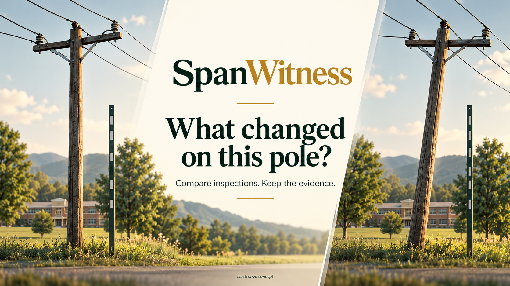

# SpanWitness

**Has this pole changed since its last inspection?**

A pole beside a school looks different this week. Did its alignment change, or did the camera move? An inspection team needs comparable evidence before deciding what to review. Separate photos and unexplained defect scores make that decision harder.

SpanWitness saves observations against an asset, compares a dated baseline with a later image and keeps the measurements with a human review request. A constrained image-alignment comparison checks the fixed reference and surrounding scene. It can ask for another capture when the evidence is unsuitable.

The original conductor and vegetation workflow also screens visible evidence and requests a second view for suspicious overlap. A tree behind a wire can look like contact in a single image.

This is an independent hackathon prototype. No workplace code or images are included.



*AI-generated concept art. The working demo uses labeled synthetic fixtures and credited field photographs.*

## Watch the demo

[1080p narrated demo on YouTube](https://youtu.be/00i3KlrgI1c). It starts with the problem, gives the real-life example, shows the approach and working application, then explains the technical path and results. The narration uses edited Suno Speech. The app captures use synthetic scenes with illustrative dates.

The [Devpost project](https://devpost.com/software/spanwitness) contains the write-up and gallery. Submission status is verified separately in the contest portal.

## Try the local application

The [private AWS preview](https://ec1f3mu6m7.execute-api.us-west-2.amazonaws.com) is deployed and verified. Access details are in [DEPLOYMENT.md](spanwitness/DEPLOYMENT.md). Its actual image processing runs in Lambda with private S3 and DynamoDB storage.

Python 3.14 was used for development. Run commands from the repository root.

```sh
python3.14 -m venv .venv
.venv/bin/python -m pip install -r spanwitness/requirements-dev.txt
.venv/bin/python -m uvicorn spanwitness.app:app --host 127.0.0.1 --port 8765
```

Open http://127.0.0.1:8765.

1. Select **A suspicious overlap**, then **Analyze observation**. The image measurement triggers a second-view request.
2. Select **Compare a second viewpoint**. OpenCV matches landmarks and checks that the selected conductor corresponds between the images. A reduced overlap changes the review plan.
3. Repeat with **Overlap in both views**. The overlap persists and the plan requests a qualified clearance inspection.
4. Try **Pole alignment candidate** and **Camera roll, upright pole**. The second case has a rotated image, but almost no relative axis difference.
5. Stage a review with a reviewer name, note and confirmation. Search the saved observations in **Archive** or download the JSON evidence record.
6. Open **Asset history** and run **A changed pole alignment**. Compare the baseline and current evidence, then try **Only the camera rotates** and the two refusal controls. Each button saves actual synthetic observations with explicitly illustrative dates.

For your own history, supply the asset ID and observation time under **Observation date and asset context**. Mark the pole and the same fixed reference in each image. In **Asset history**, select the two observations and confirm the repeatable capture setup. The saved-record date is never silently used as a photo capture date.

The example picker contains eight controlled synthetic cases and two licensed field photographs. Synthetic examples test decisions; the field photographs have no validated condition labels.

## Implemented

- Image upload, EXIF orientation correction and browser resizing for phone photos.
- Camera sampling once every three seconds, up to ten observations. Camera access requires the user's browser permission and localhost or HTTPS.
- Operator-marked conductor paths, plus an automatic Hough-line candidate when no path is marked.
- Visible line-support checks and possible gap or occlusion candidates.
- Color-based vegetation candidates near the selected span, plus a coarse ground-cover screen.
- Pole-axis and reference-edge fits with OpenCV's Huber line estimator.
- ORB feature matching, RANSAC registration and a selected-span correspondence check before comparing projected overlap.
- Bounded next-action policy, evidence overlays, hashes, source credits, keyword search and a human review queue.
- A dated asset timeline, baseline/current selectors, saved pole-history comparisons, comparison exports and human-reviewed change requests.
- Optional live NWS fire-weather alerts for entered US coordinates. Unavailable alerts and an absence of alerts never establish low fire danger.
- SQLite and local images for development; an S3/DynamoDB backend and Lambda container for AWS deployment.

## What the numbers mean

The app reports pixels, visible edge support, color coverage and image-axis differences. These are measurements of the view. It does not measure physical conductor clearance, establish electrical contact, classify grass species, estimate fuel moisture or calculate fire-spread probability.

The priorities are a declared prototype policy: routine, moderate, major, critical review or more evidence needed. They are requests for review, not certified severity ratings. A possible gap can also be a path error, poor contrast or an occlusion.

The pole workflow needs a suitable reference selected by the operator. Subtracting two image orientations helps with camera roll; perspective and depth still affect the result. True physical pole lean needs calibrated evidence and specialist review.

The history path excludes the marked pole from background registration, checks a similarity fit against projective variation and verifies the selected reference and pole position. It declines unsupported comparisons. Its 3-degree apparent-change threshold is a prototype review setting, not a utility standard. Capture setup, identity, dates and location remain operator supplied. Neither an accepted comparison nor a no-change result establishes structural safety.

## Tests and evaluation

```sh
.venv/bin/python -m pytest spanwitness/tests -q
.venv/bin/python -m spanwitness.scripts.evaluate
.venv/bin/python -m spanwitness.scripts.evaluate_history
node --check spanwitness/static/app.js
```

See [evaluation results](spanwitness/reports/EVALUATION.md), the [technical report](spanwitness/TECHNICAL_REPORT.md) and the [capture guide](spanwitness/CAPTURE_GUIDE.md). The initial stress-check failures are preserved in `reports/baseline-evaluation.json`. The revised method was adjusted after those failures, so the stress matrix is not a held-out benchmark.

History development results and their initial failures are recorded in [HISTORY_EVALUATION.md](spanwitness/reports/HISTORY_EVALUATION.md). They are controlled image checks, not field accuracy.

The AWS SDK tests use stubbed responses. Separately, the [live AWS checks](spanwitness/reports/AWS_LIVE.md) verified actual OpenCV execution, authenticated access, image readback, record persistence and the second-view decision.

## AWS

See [deployment instructions](spanwitness/DEPLOYMENT.md). The deployed AWS path runs the actual OpenCV workload in Lambda, stores evidence images in private S3 and keeps observations/review requests in DynamoDB. API Gateway serves the same interface and API.

No Bedrock model, trained defect detector or external crew-notification service is claimed. Two local pole-classification experiments did not meet the declared acceptance boundary and are excluded from the application. See [model development results](spanwitness/reports/MODEL_DEVELOPMENT.md).

## Data and source

The procedural scenes are original code-generated fixtures. Field photographs are credited in [DATA.md](spanwitness/DATA.md) and [ATTRIBUTION.json](spanwitness/static/samples/ATTRIBUTION.json). Preserve their CC BY-SA 2.0 attribution and license when distributing images or overlays.

For additional real images, see the [public dataset catalog and downloader](spanwitness/datasets/SOURCES.md). Downloaded reference labels are kept separate from the application's measurements. They do not become predictions merely by appearing in a dataset.

The local `data/` directory contains uploaded images and review records. It is excluded from source control and source archives. Archive search and asset history cover the newest 100 observations; history also covers the newest 100 comparisons. Search uses declared keyword filters, not an LLM or an unrestricted natural-language query engine.
