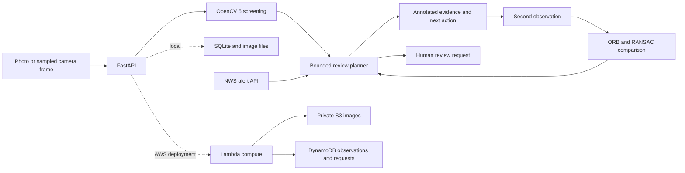

# SpanWitness technical report

## Problem and contribution

A pole beside a school looks different from its previous inspection. Did the pole's apparent alignment change, or did the camera rotate? The reviewer needs comparable observations and a clear reason for the next inspection.

SpanWitness groups dated observations by asset, compares a selected baseline with a later image and preserves the evidence in a human review request. The comparison checks the marked reference and background correspondence, then either measures an apparent image change or asks for another capture. The original conductor and vegetation checks remain available.

The contribution is the inspection workflow and its evidence record. Utility inspection, line fitting, vegetation segmentation and feature matching are established methods. No claim of a new inspection algorithm or unseen research topic is made. The primary users are inspection reviewers and operators who collect repeat observations.

The demo tests a known drawn alignment change, camera rotation and unsuitable comparisons. It also tests whether a second view changes the response to projected vegetation overlap. Technical details follow the problem and approach.

## OpenCV 5 workload

The pinned distribution is `opencv-python-headless==5.0.0.93`; the runtime reports OpenCV `5.0.0`.

1. Decode, orient and resize the image. Reject unsupported formats, oversized uploads and very small images.
2. Compute sharpness on an 800-pixel-wide reference image. Screen severe darkness and clipping separately.
3. Segment green and tan color candidates in HSV. Morphological operations and a minimum connected-component size suppress isolated color artifacts.
4. For a conductor, sample an operator-marked polyline or propose a Hough-line candidate. Compute distance to color candidates and local Canny-edge support. Long sections without support become gap or occlusion candidates.
5. For a pole, filter directional edges inside the marked pole and reference corridors. Select a long supported Hough edge, then fit its nearby points using `cv2.fitLine` with `DIST_HUBER`. Compare the image orientations. This avoids fitting crossarms and unrelated wall texture together with the selected axis.
6. For two conductor observations, extract ORB descriptors, apply a ratio test, estimate a RANSAC homography and check selected-path alignment. Reject duplicates, weak correspondence and different paths. Compare image-space overlap only after these gates pass.

The quality threshold, color bands, screening corridor and review thresholds are prototype settings. They are not utility standards or calibrated probabilities. Color segmentation can miss vegetation and can classify other green objects as candidates. A candidate line can be a fence or roof edge. The operator can correct it.

## Decisions and human review

The planner is deterministic and bounded. OpenCV measurements change its next action: request a clearer view, request a second viewpoint, retain an unresolved finding, request structural or engineering review, or stage a vegetation review.

A failed comparison cannot clear an earlier finding or overwrite a stronger new finding. A previous critical-review request survives a later clear-looking image. Human confirmation is required to stage a review record. No dispatch command or external notification is sent.

This is an adaptive evidence-gathering workflow. It is not an LLM agent. Any submission category that requires additional model-driven planning must be checked separately.

## Architecture

The AWS branch is deployed. The live health endpoint reports OpenCV `5.0.0` and storage `aws_s3_dynamodb`. Verification included uploaded-image and overlay readback, evidence export and the second-view decision. See [the cloud verification record](reports/AWS_LIVE.md). The local application uses SQLite and image files.

## Evidence and provenance

Each observation stores the input hash, stored-image hash, method version, actual runtime version, measurements, policy trace and any reference-observation ID. Known bundled field photographs retain their source credits in the record. Source categories are client-declared and do not establish camera liveness.

Hashes support content comparison and corruption checks. They are not proof that an image depicts a real asset or that a record is immutable. A homography can support image correspondence without proving a shared 3D surface or physical clearance.

## Asset history and apparent alignment change

Observations carry an optional operator-supplied observation time and location label, separate from the server's saved-record time. History groups the newest 100 observations by the operator-assigned asset ID. Comparisons are separate durable records with both original observations, hashes, measurements, the selected capture declaration and a proposed review plan. They do not overwrite earlier findings.

The history path uses two dated pole observations. It excludes each marked pole corridor from ORB feature extraction, keeps mutual ratio-test matches and estimates a RANSAC similarity transform for image rotation, translation and uniform scale. Inlier count, fraction and spatial extent must support registration. Disagreement with a projective fit, an inconsistent fixed reference or an inconsistent marked pole base causes abstention. Repeatable capture still needs operator confirmation; background matching is not proof of identical 3D camera pose.

An accepted pair compares the two reference-relative image angles. An apparent change of at least 3 degrees triggers a provisional major review. This is a declared prototype threshold, not a utility standard, physical lean measurement or failure forecast. A new no-change result cannot close an earlier urgent finding. Reviews of a historical comparison link to the comparison export, including both observations.

Four original controlled pairs and 108 procedural variations test a known drawn change, camera rotation, changed perspective and blur. The first development failures are preserved. See [history evaluation](reports/HISTORY_EVALUATION.md). No field change-detection precision, true-lean accuracy, crack-detection capability or failure-time prediction is established.

## Evaluation and remaining evidence

Read [the generated evaluation](reports/EVALUATION.md) for the exact case counts, failures and local processing times. Procedural variations share scene geometry, and some settings were revised after inspecting their failures. These are regression and stress checks.

The two real photographs have no expert condition labels. Their execution proves that the application accepts real image files, not that its findings are correct. There is no field precision, recall, clearance error or wildfire forecast score.

The real AWS evidence path passed. Three synthetic analysis calls took 1027.1, 211.3 and 991.3 ms end to end during the recorded smoke check. These measurements include network and storage work; they are not isolated OpenCV timings or a controlled cold-start study.

Two local learned pole-appearance classifiers were trained on the publisher's train split and selected on validation macro-F1. Neither met the declared integration boundary. The app does not load their weights or report their predictions. The publisher's test split remains untouched. Read [the experiment report](reports/MODEL_DEVELOPMENT.md) for the results and limits.

Before a strong final submission, collect independent self-created footage, annotate visible conditions and test camera movement and poor contrast. Field accuracy, physical clearance and true lean remain unmeasured.
